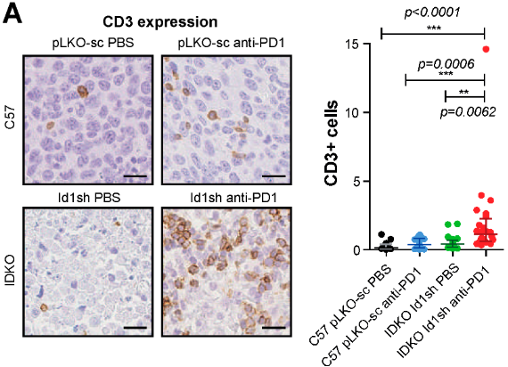

# Load libraries and themes

First, let's load the necessary libraries and create a visual theme for our plots.

```{r}
#| label: LoadPack
#| include: true
#| warning: false
#| message: false

library(ggplot2)
library(brms)
library(ggdist)
library(easystats)
library(dplyr)
library(modelr)
library(patchwork)
library(tibble)
library(tidybayes)

logit2prob <- function(logit){
  odds <- exp(logit)
  prob <- odds / (1 + odds)
  return(prob)
}

Plot_theme <- theme_classic() +
  theme(
      plot.title = element_text(size=18, hjust = 0.5, face="bold"),
      plot.subtitle = element_text(size = 10, color = "black"),
      plot.caption = element_text(size = 12, color = "black"),
      axis.line = element_line(colour = "black", size = 1.5, linetype = "solid"),
      axis.ticks.length=unit(7,"pt"),
     
      axis.title.x = element_text(colour = "black", size = 16),
      axis.text.x = element_text(colour = "black", size = 16, angle = 0, hjust = 0.5),
      axis.ticks.x = element_line(colour = "black", size = 1),
      
      axis.title.y = element_text(colour = "black", size = 16),
      axis.text.y = element_text(colour = "black", size = 16),
      axis.ticks.y = element_line(colour = "black", size = 1),
      
      legend.position="right",
      legend.direction="vertical",
      legend.title = element_text(colour="black", face="bold", size=12),
      legend.text = element_text(colour="black", size=10),
      
      plot.margin = margin(t = 10,  # Top margin
                             r = 2,  # Right margin
                             b = 10,  # Bottom margin
                             l = 10) # Left margin
      ) 
```

Counting is a fundamental task in biomedical research, particularly when analyzing cell populations. Imagine staring at countless cells within a tiny brain region—sometimes numbering in the hundreds or thousands. Yet, in other areas, these numbers may dwindle to few or even none.

The challenge arises in how we analyze these counts. For large numbers, linear models, which assume a normal distribution, often serve as a reasonable approximation. Though not optimal, they provide a logical framework for initial analysis. However, the scenario shifts dramatically when cell counts are low or predominantly zeros. Here, traditional linear models (like those t-tests we run in GraphPad) falter, losing their effectiveness and relevance.

As researchers, we must strive for better, going beyond t-tests and ANOVAs. This post aims to explore alternative statistical methods that more accurately reflect the realities of our data, especially when dealing with low or zero counts. By embracing more fitted approaches, we can enhance the precision of our findings and deepen our understanding of our cell populations.

# What is the issue with counting zeros?

In many studies, like the one shown in the graph by [@baraibar2020], we encounter the challenge of low cell counts, particularly where one group—marked here in black—appears to be dominated by zero counts. This scenario is not uncommon in biomedical literature, where straightforward linear models are frequently applied to analyze such data.

{#fig-sample fig-align="center"}

However, the use of these models in cases of low or zero counts can be problematic. Without access to the original datasets—which researchers often do not share—it's difficult to evaluate the efficacy of the analysis fully. To better understand this issue, let's consider a separate dataset from my own research. Several years ago, I undertook the task of counting BrdU+ cells following an ischemic event in a specific brain area called the subventricular zone (SVZ). This particular experience inclined me to evaluate more suitable statistical approaches. 

These are the data:

```{r}
#| label: LoadData
#| include: true
#| warning: false
#| message: false
#| column: margin

Svz_data <- read.csv("data/CellCounts.csv")
Svz_data$Hemisphere <- factor(Svz_data$Hemisphere, levels = c("Contralateral", "Ipsilateral"))
head(Svz_data)
```

We can visualize that the contralateral hemisphere has a lot of null cell counts. We can have a better angle if we use a boxplot:

```{r}
#| label: fig-EDA
#| include: true
#| warning: false
#| message: false
#| fig-cap: Cell counts by hemisphere.
#| fig-height: 5
#| fig-width: 6

ggplot(Svz_data, aes(x = Hemisphere, y = Cells)) +
  geom_boxplot() +
  labs(x = "Hemisphere", y = "Number of cells", title = "Cells by hemisphere") +
  Plot_theme +
  theme(legend.position = "top", legend.direction = "horizontal")
```

@fig-EDA vividly illustrates the substantial disparities in cell counts across hemispheres.To examine what happens when we apply a typical (and horrific) linear model to such data, we'll proceed with a practical demonstration using the `brms`. This will help us understand the effects of these variations when analyzed under a traditional framework predicated on normal distribution assumptions. 

In this example, I'll fit a linear model where the factor variable "hemisphere" is the sole predictor of the cell counts:

```{r}
#| label: Lm_Fit
#| include: true
#| warning: false
#| message: false

lm_Fit <- brm(Cells ~ Hemisphere, 
           data = Svz_data, 
           # seed for reproducibility purposes
           seed = 8807,
           control = list(adapt_delta = 0.99),
           # this is to save the model in my laptop
           file    = "models/lm_Fit.rds",
           file_refit = "never")

# Add loo for model comparison
lm_Fit <- 
  add_criterion(lm_Fit, c("loo", "waic", "bayes_R2"))
```

Are you willing to bet on what the results will be? Let's find out:

```{r}
#| label: Lm_summary
#| include: true
#| warning: false
#| message: false

summary(lm_Fit) 
```

If you like, you can fit a frequentist (OLS) model with `lm` and you will certainly get the same results. In these results, the intercept represents an estimate of cell counts for the contralateral hemisphere, which serves as our reference group. However, a significant inconsistency arises when employing a normal distribution for data that includes numerous zero counts or values close to zero. In such cases, the model is inappropriately "forced" to predict that cell counts in our hemisphere could be negative, such as -1 to -2 cells, with a confidence interval ranging from -1.5 to 3.7. This prediction is fundamentally flawed because it disregards the intrinsic nature of cells as entities that can only assume non-negative integer values.

This issue stems from the fact that our model, in its current form, does not comprehend the true characteristics of the data it's handling. Instead, it merely follows our directives—albeit incorrectly—to fit the data to a linear model. This common oversight often leads researchers to further exacerbate the problem by applying t-tests and ANOVAs, thereby superimposing additional analysis onto a model that is fundamentally unsound. It is imperative that we, as researchers, recognize and harness our capabilities and tools to develop and utilize more appropriate and logically sound modeling methods that respect the inherent properties of our data.

Let's plot the results using the great `TidyBayes` package [@tidybayes] by the great [Matthew Kay](https://www.mjskay.com/)

```{r}
#| label: fig-LmResults
#| include: true
#| warning: false
#| message: false
#| fig-cap: Posterior distribution for cells counts by hemisphere.
#| fig-height: 5
#| fig-width: 6

Svz_data %>%
  data_grid(Hemisphere) %>%
  add_epred_draws(lm_Fit) %>%
  ggplot(aes(x = .epred, y = Hemisphere)) +
  labs(x = "Number of cells") +
  stat_halfeye() +
  geom_vline(xintercept = 0) +
  Plot_theme
```

We can also see this inconsistency if we perform `pp_check` to compare the observations with the model predictions:

```{r}
#| label: fig-Lm_ppchek
#| include: true
#| warning: false
#| message: false
#| fig-cap: Posterior predictive checks gaussian model.
#| fig-height: 5
#| fig-width: 6

pp_check(lm_Fit, ndraws = 100) +
  labs(title = "Gaussian regression") +
  theme_classic()
```
Once again, we encounter irrational predictions of cell counts falling below zero. As scientists, it's crucial to reflect on the suitability of our models in relation to the data they are intended to explain. This consideration guides us toward **generative models**, which are build under the premise that they could plausibly have generated the observed data. Clearly, the linear model currently in use falls short of this criterion. It predicts impossible negative values for cell counts. Let's try to find out a better model.

## Working with lots of zeros

A zero-inflated model effectively captures the nuances of datasets characterized by a preponderance of zeros. It operates by distinguishing between two distinct processes: 1) Determining whether the result is zero, and 2) predicting the values for non-zero results. This dual approach is particularly apt for asking questions like, "Are there any cells present, and if so, how many?"

For handling datasets with an abundance of zeros, we employ models such as `hurdle_poisson()` and `Zero_inflated_poisson`, both designed for scenarios where standard count models like the Poisson or negative binomial models prove inadequate [@feng2021a].Loosely speaking, a key difference between `hurdle_poisson()` and `Zero_inflated_poisson` is that the latter incorporates an additional probability component specifically for zeros, enhancing their ability to handle datasets where zeros are not merely common but significant. We'll see the impact this features have in our modeling strategy using `brms`.  

# Fitting a hurdle_poisson model

Let's start by using the `hurdle_poisson()` distribution in our modeling scheme: 

```{r}
#| label: HurdleFit
#| include: true
#| warning: false
#| message: false
#| results: false

Hurdle_Fit1 <- brm(Cells ~ Hemisphere, 
           data = Svz_data, 
           family = hurdle_poisson(),
           # seed for reproducibility purposes
           seed = 8807,
           control = list(adapt_delta = 0.99),
           # this is to save the model in my laptop
           file    = "models/Hurdle_Fit1.rds",
           file_refit = "never")

# Add loo for model comparison
Hurdle_Fit1 <- 
  add_criterion(Hurdle_Fit1, c("loo", "waic", "bayes_R2"))
```
Let's see the results using the standard summary function.

```{r}
#| label: HurdleFit_Results
#| include: true
#| warning: false
#| message: false
#| results: false

summary(Hurdle_Fit1)

```
Given this family distribution, the estimates are shown in the log scale (mu = log). In practical terms, this means that the number of cells in the contralateral subventricular zone (SVZ) can be expressed as exp(1.11) = 3.03. Similarly, the ipsilateral hemisphere is estimated to have exp(1.07) = 2.91 times the number of cells. These results align well with our expectations and offer a coherent interpretation of the cell distribution between the two hemispheres.

Additionally, the `hu` parameter within the "Family Specific Parameters" sheds light on the likelihood of observing zero cell counts. It indicates a 38% probability of zero occurrences. This probability highlights the need for a zero-inflated model approach and justifies its use in our analysis. 

To better visualize the implications of these findings, we can leverage the `conditional_effects` function. This tool in the `brms` package allows us to plot the estimated effects of different predictors on the response variable, providing a clear graphical representation of how the predictors influence the expected cell counts. 

```{r}
#| label: fig-HurdleCE
#| include: true
#| warning: false
#| message: false
#| fig-cap: Conditional effects for the hurdle fit.
#| fig-height: 5
#| fig-width: 10

Hurdle_CE <- 
  conditional_effects(Hurdle_Fit1)

Hurdle_CE <- plot(Hurdle_CE, 
       plot = FALSE)[[1]]

Hurdle_Com <- Hurdle_CE + 
  Plot_theme +
  theme(legend.position = "bottom", legend.direction = "horizontal")


Hurdle_CE_hu <- 
  conditional_effects(Hurdle_Fit1, dpar = "hu")

Hurdle_CE_hu <- plot(Hurdle_CE_hu, 
       plot = FALSE)[[1]]

Hurdle_hu <- Hurdle_CE_hu + 
  Plot_theme +
  theme(legend.position = "bottom", legend.direction = "horizontal")

Hurdle_Com | Hurdle_hu
```

These plots draw a more logical picture than our first model. The graph on the left shows the two parts of the model ("mu" and "hu"). Also, if this model is suitable, we should see more aligned predictions when using `pp_check`:

```{r}
#| label: fig-Hurdel_CE
#| include: true
#| warning: false
#| message: false
#| fig-cap: Posterior predictive checks hurdle model.
#| fig-height: 5
#| fig-width: 6

pp_check(Hurdle_Fit1, ndraws = 100) +
  labs(title = "Hurdle regression") +
  theme_classic()
```

As expected, our model predictions have a lower boundary at 0. 

## Modeling the dispersion of the data

Observing the data presented in the right graph of @fig-HurdleCE reveals a discrepancy between our empirical findings and our theoretical understanding of the subject. Based on established knowledge, we expect a higher probability of non-zero cell counts in the subventricular zone (SVZ) of the ipsilateral hemisphere, especially following an injury. This is because the ipsilateral SVZ typically becomes a hub of cellular activity, with significant cell proliferation post-injury. Our data, indicating prevalent non-zero counts in this region, supports this biological expectation.

However, the current model predictions do not fully align with these insights. This divergence underscores the importance of incorporating scientific understanding into our statistical modeling. Relying solely on standard tests without contextual adaptation can lead to misleading conclusions.

To address this, we can refine our model by specifically adjusting the `hu` parameter, which represents the probability of zero occurrences. This allows us to more accurately reflect the expected biological activity in the ipsilateral hemisphere's SVZ. We build then a second hurdle model:

```{r}
#| label: HurdleFit2
#| include: true
#| warning: false
#| message: false
#| results: false

Hurdle_Mdl2 <- bf(Cells ~ Hemisphere, 
                   hu ~ Hemisphere)
  
Hurdle_Fit2 <- brm(
           formula = Hurdle_Mdl2,
           data = Svz_data, 
           family = hurdle_poisson(),
           # seed for reproducibility purposes
           seed = 8807,
           control = list(adapt_delta = 0.99),
           # this is to save the model in my laptop
           file    = "models/Hurdle_Fit2.rds",
           file_refit = "never")
           

# Add loo for model comparison
Hurdle_Fit2 <- 
  add_criterion(Hurdle_Fit2, c("loo", "waic", "bayes_R2"))
```

Let's see first if the results graph aligns with our hypothesis:

```{r}
#| label: fig-HurdleCE2
#| include: true
#| warning: false
#| message: false
#| fig-cap: Conditional effects for the hurdle fit 2.
#| fig-height: 5
#| fig-width: 10

Hurdle_CE <- 
  conditional_effects(Hurdle_Fit2)

Hurdle_CE <- plot(Hurdle_CE, 
       plot = FALSE)[[1]]

Hurdle_Com <- Hurdle_CE + 
  Plot_theme +
  theme(legend.position = "bottom", legend.direction = "horizontal")


Hurdle_CE_hu <- 
  conditional_effects(Hurdle_Fit2, dpar = "hu")

Hurdle_CE_hu <- plot(Hurdle_CE_hu, 
       plot = FALSE)[[1]]

Hurdle_hu <- Hurdle_CE_hu + 
  Plot_theme +
  theme(legend.position = "bottom", legend.direction = "horizontal")

Hurdle_Com | Hurdle_hu
```

This revised modeling approach seems to be a substantial improvement. By specifically accounting for the higher probability of zero counts (~75%) in the contralateral hemisphere, the model now aligns more closely with both the observed data and our scientific knowledge. This adjustment not only reflects the expected lower cell activity in this region but also enhances the precision of our estimates. With these changes, the model now offers a more nuanced interpretation of cellular dynamics post-injury. Let's see the summary and the TRANSFORMATION FOR THE `hu` parameters (do not look the others) to visualize them in a probability scale using the `logit2prob` [function](https://sebastiansauer.github.io/convert_logit2prob/) we created at the beginning.   

```{r}
#| label: HurdleFit_Results2
#| include: true
#| warning: false
#| message: false
#| results: false

summary(Hurdle_Fit2)

logit2prob(fixef(Hurdle_Fit2))
```
Although the estimates for the number of cells are similar, the `hu` parameters (in the logit scale) tells us that the probability for seeing zeros in the contralateral hemisphere is:

$$
\text{Probability} = \frac{1}{1 + \exp(-1.34)} \approx 0.792 
$$
Conversely: 

$$
\text{Probability} = \frac{1}{1 + \exp(6.04)} \approx 0.0023 
$$
Depicts a drastic reduction to about 0.23% probability of observing zero cell counts in the injured (ipsilateral) hemisphere. This is a remarkable change in our estimates.

Now, let's explore if a `zero_inflated_poisson()` distribution family changes these insights. 


# Fitting a zero-inflated Poisson model

As we modeled the broad variations in cell counts between the ipsilateral and contralateral hemispheres using the `hu` parameter, we'll fit as well these two parts of the model in our `zero_inflated_poisson()`. Here, the count part of the model uses a "log" link, and the excess of zeros is modeled with a "logit" link. These are linked functions associated to the distribution family that we'll not discuss here. 

```{r}
#| label: InflatedFit
#| include: true
#| warning: false
#| message: false
#| results: false


Inflated_mdl1 <- bf(Cells ~ Hemisphere,
                    zi ~ Hemisphere)

Inflated_Fit1 <- brm(
           formula = Inflated_mdl1, 
           data = Svz_data, 
           family = zero_inflated_poisson(),
           # seed for reproducibility purposes
           seed = 8807,
           control = list(adapt_delta = 0.99),
           # this is to save the model in my laptop
           file    = "models/Inflated_Fit.rds",
           file_refit = "never")

# Add loo for model comparison
Inflated_Fit1 <- 
  add_criterion(Inflated_Fit1, c("loo", "waic", "bayes_R2"))
```
Before we look at the results, let's do some basic diagnostics to compare the observations and the model predictions.

## Model diagnostics

```{r}
#| label: fig-ZeroInflatedDiag1
#| include: true
#| warning: false
#| message: false
#| fig-cap: Model diagnostics for the zero-inflated regression
#| fig-height: 4
#| fig-width: 5

set.seed(8807)

pp_check(Inflated_Fit1, ndraws = 100) +
  labs(title = "Zero-inflated regression") +
  theme_classic()
```
From @fig-ZeroInflatedDiag1, we can see that the predictions deviate from the observed data in a similar way to the hurdle model. So, we have no major changes up to this point.

## Model results

Let's see the numerical results:

```{r}
#| label: InflatedFit_Results
#| include: true
#| warning: false
#| message: false
#| results: false

summary(Inflated_Fit1)

logit2prob(fixef(Inflated_Fit1))

```
Here, we do see tiny changes in the estimatess. The estimate for the number of cells is similar with small changes in the credible intervals. Otherwise, the parameter for the number of zeros seems to experience a larger shift. Let's see if this has any effect on our conclusions:

$$
\text{Probability} = \frac{1}{1 + \exp(1.21)} \approx 0.771 
$$
Indicates that there is approximately a 77% probability of observing zero counts in the reference hemisphere. Now, for the injured hemisphere, we have:

$$
\text{Probability} = \frac{1}{1 + \exp(5.88)} \approx 0.0027 
$$
Again, this signals a drastic reduction in observing zero cell counts in the injured (ipsilateral) hemisphere. Evaluating the results using scientific knowledge, I would say that both models provide similarly sound predictions. The graphical results for our `zero_inflated_poisson` model are as follows:

## Model plots

```{r}
#| label: fig-InflatedCE
#| include: true
#| warning: false
#| message: false
#| fig-cap: Conditional effects for the Inflated fit.
#| fig-height: 5
#| fig-width: 10

Inflated_CE <- 
  conditional_effects(Inflated_Fit1)

Inflated_CE <- plot(Inflated_CE, 
       plot = FALSE)[[1]]

Inflated_Com <- Inflated_CE + 
  Plot_theme +
  theme(legend.position = "bottom", legend.direction = "horizontal")


Inflated_CE_zi <- 
  conditional_effects(Inflated_Fit1, dpar = "zi")

Inflated_CE_zi <- plot(Inflated_CE_zi, 
       plot = FALSE)[[1]]

Inflated_zi <- Inflated_CE_zi + 
  Plot_theme +
  theme(legend.position = "bottom", legend.direction = "horizontal")

Inflated_Com | Inflated_zi
```

The results seem analogous to those of the hurdle model. However, we can observe that the estimates for the probability of 0 in the contralateral hemisphere is more restrictive for the `zero_inflated_poisson`. The reason is, as I explained at the beginning, that the zero-inflated model locates a larger probability of zeros than the `hurdle_poisson` distribution. Let's compare the models to finish this post. 


# Model comparison

We carry out leave-one-out cross validation using the the `loo` package [@loo; @vehtari2016]. WAIC [@gelman2013] is another approach you can explore in [this](https://medium.com/towards-data-science/do-not-over-think-about-outliers-use-a-student-t-distribution-instead-b6c584b91d5c) post.

```{r}
#| label: Models_Compare
#| include: true
#| warning: false
#| message: false
#| results: false

loo(Hurdle_Fit2, Inflated_Fit1)
```
Even though if our model predictions are alike, the "pareto-k-diagnostic" indicates that the `hurdle_poisson` model has 1 `very bad` value, whereas this value shifts to `bad` in the `zero_inflated_poisson()`. I judge that this "bad and very bad" value may be a product of the extreme observation that we see as a black dot in the contralateral count in @fig-EDA. We could fit another model excluding this value and re-evaluate the results. However, this procedure would only aim to evaluate the effect of this extreme observation and inform the audience of a possible bias in the estimates (which should be fully reported). This is a thorough and transparent way to interpret the data. I wrote another [post](https://medium.com/towards-data-science/do-not-over-think-about-outliers-use-a-student-t-distribution-instead-b6c584b91d5c) concerning extreme values that may be of interest to you.  

I conclude that the modeling performed in this post is a more appropriate approach than a naive linear model based on a Gaussian distribution. It is an ethical and professional responsibility of scientists to use the most appropriate statistical modeling tools available. Fortunately, `brms` exists!  

I would appreciate your comments or feedback letting me know if this journey was useful to you. If you want more quality content on data science and other topics, you might consider becoming a [medium member](https://medium.com/membership).

In the future, you can find an updated version of this post on my [GitHub site](https://github.com/daniel-manrique/MediumBlog/blob/main/2024-04-19_CountsZeroInflated.qmd).

-   All images, unless otherwise stated, were generated using the displayed R code.

# References

::: {#refs}
:::

```{r}
sessionInfo()
```
